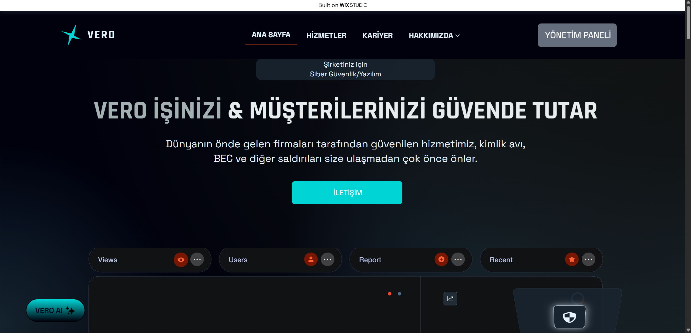
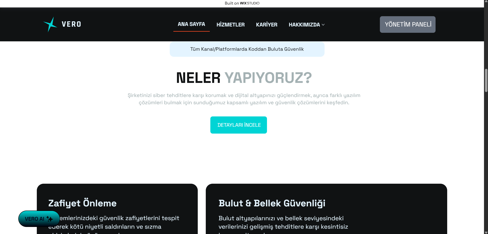
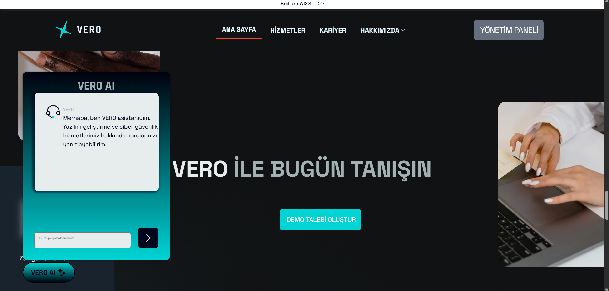
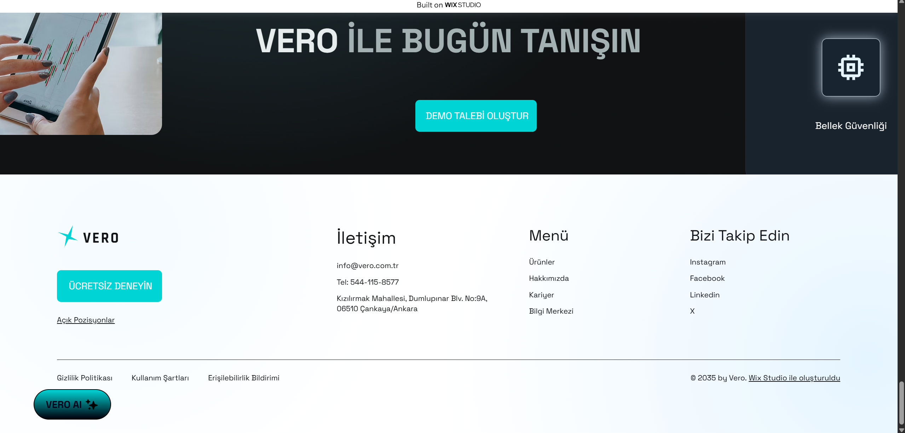
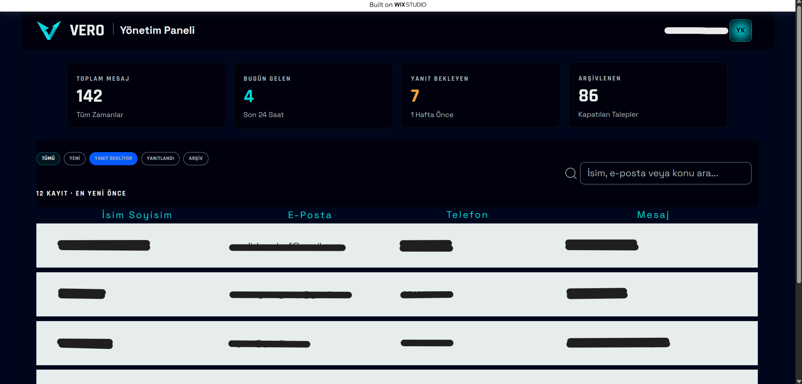
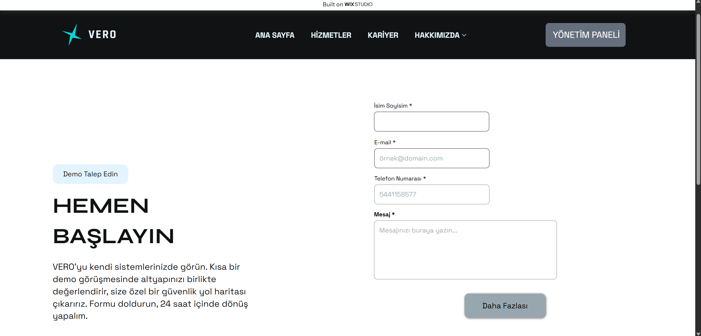

# VERO SmartLead AI

*Gerçek Deneyim. Gerçek Güven.*

VERO SmartLead AI, VERO'nun web sitesi için geliştirilen yapay zeka destekli satış asistanıdır. Siteyi ziyaret edenlerle Türkçe sohbet eder, VERO'nun hizmetlerini anlatır ve sohbetin uygun bir noktasında ziyaretçiyi teklif alabilmesi için isim ve telefon bilgisi bırakmaya yönlendirir.

VERO; mevcut markalara ve bireylere yönelik yazılım geliştirme ve siber güvenlik danışmanlığı sunan, tamamen dijital çalışan bir markadır.

## Proje Yapısı
- `app/` — Flask ile yazılmış sohbet asistanı backend'i (Render'da çalışır)
- `wix-frontend/` — Wix Studio üzerinde geliştirilen sitenin ön yüz kodları (yalnızca inceleme amaçlı kopya; site Wix üzerinde yayında)

  
  
  

  
  
  

## Özellikler

- Groq altyapısıyla çalışan Türkçe sohbet asistanı
- VERO hizmetlerini anlatma: güvenlik denetimi, sızma testi, yazılım geliştirme desteği ve 7/24 teknik destek
- Sohbet sırasında potansiyel müşteri (lead) toplama: isim ve telefon
- SQLite ile hafif ve kurulumu kolay veri saklama
- Ortam değişkenleriyle yapılandırma, geliştirme ve üretim ortamı ayrımı
- Asistanın davranışını değiştirebilen özelleştirilebilir iş bağlamı
- CORS desteği ile web sitesinden gelen isteklere açık yapı
- Render üzerinde yayınlamaya hazır (Procfile + Gunicorn)

## Teknolojiler

| Alan | Teknoloji |
|---|---|
| Dil | Python |
| Web çatısı | Flask 3.0.3 |
| Yapay zeka | Groq API |
| Veritabanı | SQLite |
| Diğer | flask-cors, python-dotenv, requests |
| Canlı sunucu | Gunicorn |
| Barındırma | Render |